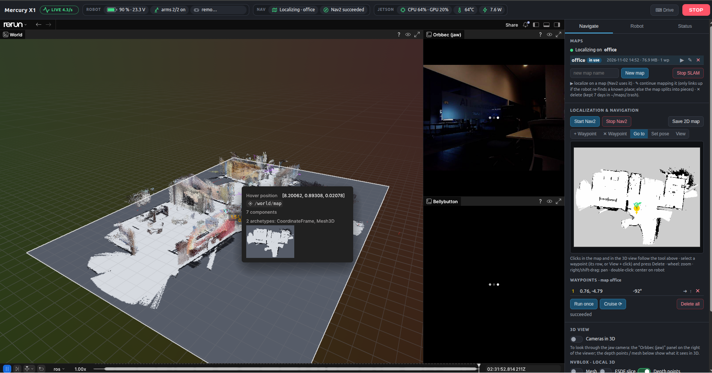
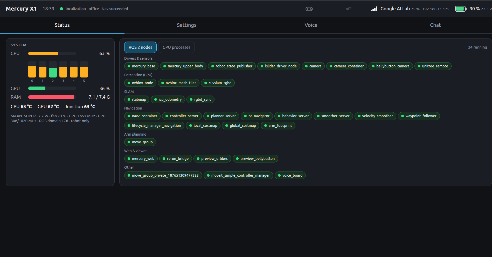

# mercury_x1_ros2

ROS 2 Jazzy stack for the Elephant Robotics **Mercury X1** (wheeled dual-arm humanoid, Jetson Orin NX 16 GB on
JetPack 7.2 - the `humble` branch is the earlier Orin Nano / JetPack 6 / Humble version):
C++ hardware drivers, RTAB-Map SLAM, Nav2, MoveIt for the arms, on-robot speech, and two web UIs (a Rerun-based
control page and a touch kiosk on the head display).

<p align="center">
  
</p>
<p align="center">
  
</p>

## Contents

- [Quick start](#quick-start)
- [Running on the robot](#running-on-the-robot): [autostart](#autostart) · [ROS environment and network](#ros-environment-and-network) · [robot-side dependencies](#robot-side-dependencies)
- [Web UIs](#web-uis): [control page :8080](#control-page-8080) · [head display :8081](#head-display-8081)
- [SLAM and navigation](#slam-and-navigation): [mapping](#mapping) · [named places](#named-places-voice-go-to-the-kitchen) · [maps and waypoints](#maps-and-waypoints) · [Nav2](#nav2-in-one-process) · [arm-aware footprint](#arm-aware-footprint)
- [Arms: MoveIt](#arms-moveit-planning-ik-self-collision)
- [Voice](#voice): [voice chat](#voice-chat-head-display--chat-tab) · [voice board](#voice-board-iflytek-xfm-dp-4-mic-array-in-the-head)
- [Packages and interfaces](#packages-and-interfaces)
- [Original vendor README](#original-vendor-readme)

## Quick start

```bash
./deploy.sh                                   # rsync to elephant@192.168.11.175 (REMOTE_HOST=... to override)
ssh elephant@192.168.11.175 'cd ~/mercury_x1_ros2 && colcon build --packages-up-to mercury_x1_bringup mercury_x1_web'
ssh elephant@192.168.11.175 '~/mercury_x1_ros2/start.sh'             # whole stack: hardware + page + SLAM + Nav2
ssh elephant@192.168.11.175 '~/mercury_x1_ros2/scripts/mx1_up.sh'    # ... or only hardware + Rerun bridge + page
open http://192.168.11.175:8080               # SLAM / Nav2 / waypoints / teleop from the page
ssh elephant@192.168.11.175 '~/mercury_x1_ros2/scripts/mx1_stop.sh'  # stop everything (rtabmap saves the map)
```

| Service | Where |
|---|---|
| Control page (Rerun 3D, maps, Nav2, arms) | `http://<robot>:8080` |
| Head display / kiosk (status, settings, voice, chat) | `http://<robot>:8081` |
| Rerun gRPC / viewer | :9876 / :9090 |
| Speech service (VAD + ASR + TTS, local only) | 127.0.0.1:8097 |

## Running on the robot

### Autostart
`scripts/install_autostart.sh` installs the systemd unit `mercury-x1` (`config/systemd/`), which runs `./start.sh`
at boot: SLAM continues the most recently saved map (`~/maps/*.db`) in mapping mode, then Nav2. Override in
`~/.config/mercury_x1/autostart.env` (`MX1_MAP=office`, `MX1_MODE=localization`, `MX1_SLAM=false`, `MX1_NAV=false`,
`MX1_ROBOT_ARGS=...` for `robot.launch.py`). `sudo systemctl stop|start|restart mercury-x1`, `journalctl -u mercury-x1`.

The robot needs `RemoveIPC=no` (`/etc/systemd/logind.conf.d/90-mercury-keep-ipc.conf`): otherwise logind deletes
the stack's Fast-DDS shared memory whenever the last ssh session closes, and later processes can't connect.

### ROS environment and network
`scripts/ros_env.sh` (sourced by every script and `~/mx1_env.sh`): `ROS_DOMAIN_ID=176`. ROS network **robot only**
(default: Fast-DDS UDP on loopback only, `config/fastdds_localhost.xml`, no DDS multicast on the WiFi) or **LAN**
(`config/fastdds_lan.xml`, other machines can join). The switch is on the page (Robot tab, "ROS 2 network"); it is
saved in `~/.config/mercury_x1/ros_network` and restarts the stack (`scripts/mx1_restart.sh`), with SLAM / Nav2
resuming as they were. The page and viewer use HTTP / gRPC, so they work in both modes.

### Robot-side dependencies
Platform: JetPack 7.2.1 (L4T R39.2.1, Ubuntu 24.04, CUDA 13.2), ROS 2 Jazzy from apt, Isaac ROS 4.6 from
`deb [signed-by=/usr/share/keyrings/nvidia-isaac-ros.gpg] https://isaac.download.nvidia.com/isaac-ros/release-4.6 noble-jetpack main`
(`ros-jazzy-isaac-ros-visual-slam ros-jazzy-nvblox-ros ros-jazzy-nvblox-nav2 ros-jazzy-nvblox-msgs` - not the
`isaac-ros-nvblox` metapackage, it drags in triton-server, which does not install on Jetson). ROS packages:
`ros-jazzy-desktop navigation2 nav2-bringup nav2-mppi-controller rtabmap-ros slam-toolbox moveit moveit-planners-ompl
pick-ik usb-cam joy image-transport-plugins depthimage-to-laserscan robot-localization cv-bridge pcl-ros backward-ros
ackermann-msgs xacro joint-state-publisher-gui`; build deps `libyuv-dev libpcap-dev libpcl-dev libgflags-dev
libgoogle-glog-dev libdw-dev nlohmann-json3-dev libbluetooth-dev libeigen3-dev` (`rosdep install --from-paths src
--ignore-src --rosdistro jazzy` covers the rest). Build with `PATH=/usr/local/cuda/bin:$PATH` and
`--cmake-args -DUSE_NV_HW_DECODER=ON` (Jetson JPEG decoder in orbbec_camera; on JetPack 7 it links CUDA nvJPEG +
libnvmm_jpeg instead of the old Tegra libnvjpeg).

pip (user site, `--break-system-packages`): `"numpy>=2,<2.4" scipy trimesh "rerun-sdk==0.39.0" "pandas>=2.2,<3" "aiohttp>=3.10"`
(rerun's pyarrow needs numpy 2; the apt scipy/pandas are built against numpy 1, so they come from pip too; the apt
aiohttp 3.9 lacks `ClientWSTimeout`, which the voice chat uses). The page
serves the matching `@rerun-io/web-viewer` (`VIEWER_VERSION` in `web_server.py`, fetched once from jsDelivr).
Kiosk: `sudo apt install surf matchbox-window-manager xinit`. Speech: `server/robot_speech/setup.sh` (own venv;
onnxruntime-gpu for CUDA 13 from the Jetson AI Lab `sbsa/cu130` index - it runs on the Orin).

Power: the Jetson carrier is fed by the robot's 24 V -> 12 V converter, an RT7272B (3 A, i.e. ~36 W for module +
cameras + lidar + display). Any big load step on top of a running Jetson folds it and the module resets (abrupt journal
end; PMC `reset_reason` is not reliable - SYS_RESET_N also follows a clean reboot): a MAXN start-up, the speech
service's CUDA model load, the arms' servo power-on. Measured on 2026-11-03, the module's own 5 V (`VDD_IN`) stays
clean, the fold is upstream. What runs now:

* clocks capped at boot by `mercury-clocks.service` (CPU 1.42 GHz, GPU 612 MHz = the 15 W limits) with all 8 cores
  (custom nvpmodel profile `15W_8CORE`, ID 4 in `/etc/nvpmodel.conf`; the stock 15 W profile has 4 cores, and the
  custom profile does not apply its caps at boot, hence the unit);
* one supply step at a time: `start.sh` starts the speech service first (CUDA load, arms still unpowered), then powers
  the arms through the page API (right, left 3 s later: `power_switch_stagger_s`), then SLAM / Nav2. The driver does
  not power the arms itself (`power_on_start: false`) and `mercury-speech` is not enabled in systemd for the same
  reason (`MX1_SPEECH=false` / `MX1_ARMS=false` in `autostart.env` skip the steps);
* the Status tab shows the module input (`VDD_IN`, 5 V nominal) with its minimum since start; docker is disabled.

Hardware fix pending: a 12 V converter with headroom (>= 5-6 A) for the Jetson, or its own supply from the battery.

## Web UIs

### Control page (:8080)
`web_server` + `rerun_bridge` (`src/visualization/mercury_x1_web`). Tabs: **Navigate** (maps, Nav2, waypoints, 2D map),
**Robot** (head & waist, light & arms, MoveIt poses, ROS network), **Status**.

**3D view layers.** The Rerun server keeps 64 MiB of history and replays it **newest first** to a new viewer (the
live view shows at once, history fills in behind). Page → "3D view": **Cameras in 3D** (frustums of the jaw and
bellybutton cameras with the live image, 2 Hz; default on); nvblox: Mesh + Depth points (default; shown as 5 cm
voxels, mapping uses the full depth), ESDF slice (distance to obstacles at the costmap slice height, what Nav2 uses),
Depth points (back-projected depth, downsampled to 40k), TSDF voxels, Colour voxels, Occupancy. The choice is the
`nvblox_layers` parameter of `rerun_bridge`, saved in `~/.config/mercury_x1/viz_layers.json`; layers that are off
are not subscribed at all.

**Clicking in 3D.** The map is logged as a pickable floor mesh: a plain click on it is sent to the robot and becomes
a waypoint / go-to goal / initial pose / nothing, depending on the click mode chosen on the page
(+ Waypoint · ✕ Waypoint · Go to · Set pose · View). Clicks on the robot model and camera images are ignored.

**Keyboard driving.** The **⌨ Drive** button (W/A/S/D or arrows, Shift = fast, Space = stop, Esc releases).

### Head display (:8081)
The head panel (1280x720 HDMI + USB touch) shows a lightweight touch UI served by `web_server` (also usable from any
browser): status bar (battery % / V / ⚡, Wi-Fi network, signal, IP), **Status** (CPU per core, GPU, RAM,
temperatures; ROS nodes as bubbles grouped by subsystem, red when a needed one is missing; GPU processes with memory),
**Settings** (Wi-Fi scan + connect with an on-screen keyboard, arm power / freedrive, waist, LED colour, Unitree
remote), **Voice** (wake word, direction radar, voice output) and **Chat** (voice chat). Status is pushed at 1 Hz;
no Rerun. The kiosk is `mercury-x1-head.service`: bare Xorg on tty1 + matchbox (kiosk WM) + surf (WebKitGTK),
`scripts/head_kiosk.sh`; ~4 % of one core, ~390 MB. Wi-Fi changes run `sudo -n nmcli` (NetworkManager falls back
to the previous network if the new one fails).

## SLAM and navigation

### Mapping
Starting **mapping** levels the head first (neck 0°, jaw −5.7° = camera horizontal) and the page refuses head
moves while mapping runs; RTAB-Map's 2D grid uses the lidar **and** the depth camera (`Grid/Sensor 2`), so tables /
overhangs between 6 cm and 1.4 m end up in the saved map.

The page's **SLAM 3D map → Voxel map** layer is the whole map from the stored RGB-D frames: web_server sends it at
3 cm, the bridge re-voxelises it at the page's size (3–20 cm) as round points or solid cubes, in 2 m tiles
(`rtabmap-export`, re-exported only when the graph changed, ≤ every 30 s while mapping; the bridge re-sends only
changed tiles), fitted to the live map frame on the nodes both share (`Grid/3D` stays off: a database reprocessed
with it gave a 2D map of a single scan fan). **Export cloud / Export mesh** write a .ply / zipped textured .obj via
`rtabmap-export` to `~/maps/exports` (downloads on the page). Exports copy the database byte-wise: never open the
live `.db` with SQLite while rtabmap runs (rtabmap aborts on "database is locked").

**Boot = localization** on the latest map (`./start.sh`); mapping only when the map does not exist. Each mapping
start opens a new session in the database, and sessions that never get linked by a loop closure split the map
(`office` had 24 sessions in 4 disconnected pieces). Map a place in one go.

### Named places (voice "go to the kitchen")
Control page → under Waypoints → **Places**: drive the robot to a spot, type a name, **Save robot's spot**. Each
saved place has buttons to drive there and to delete it. Places are stored per map in `~/maps/<map>.places.json`
(name, x, y, yaw in the map frame, optional `aliases`). Voice chat resolves spoken names loosely: "the kitchen",
"kitchen area" and small typos still match. API: `place_save {name, x?, y?, yaw?}` (default: where the robot is now),
`place_delete {name}`, `place_go {name}`.

### Maps and waypoints
Page → **Maps** lists `~/maps/*.db` (newest first, size, waypoint count, which one SLAM uses): ▶ localize,
✎ continue mapping, ✕ delete (moved with its waypoints / .pgm to `~/maps/.trash/`, purged after 7 days; the map in
use cannot be deleted). **New map** starts an empty map (an existing map of that name goes to the trash first).
Waypoints belong to a map (`<name>.waypoints.json`): ✕ per row, **Delete all**, or the **✕ Waypoint** tool (click a
waypoint on the 2D map or in the 3D view).

### Nav2 in one process
`nav.launch.py` runs all Nav2 servers in one `component_container_isolated` (`/nav2_container`, one executor thread
per server; `composition:=false` for separate processes): idle CPU 72 % → 51 % of a core.

### Arm-aware footprint
`nav.launch.py` also starts `arm_footprint` (C++, `src/arm_footprint.cpp`; `arm_footprint:=false` to skip): 5 Hz,
the arm links' mesh hulls (`config/arm_hulls.yaml`, from `mercury_x1_web/tools/arm_hulls.py`) + 8 cm for a hand
beyond each flange go through TF into base_footprint. If anything sticks out more than 5 cm past the nav2.yaml
outline, `/local_costmap/footprint` and `/global_costmap/footprint` get the convex hull of the outline and those
points (+4 cm); MPPI (`consider_footprint`) and the behaviours collide-check with it. Published only on change (a new
footprint makes the costmaps re-inflate). Arms hanging: outline. (Different job from MoveIt below: this keeps the
*driving* robot from clipping things with an arm held out; MoveIt plans the *arm* motions themselves.)

## Grippers: Elephant F100 (since 2026-11-04, not yet tried on the robot)
`upper_body_node` speaks the F100 tool-port protocol (pymycobot `ForceGripper`: 0xD8 set / 0xD9 get, gripper id 14,
int16 register + value; the frames are checked in `test/test_protocol.cpp`). Every arm gets
`{left,right}_gripper/probe` (std_srvs/Trigger). It only reads status, opening, speed and torque, so it is the
safe first test of which arm has a gripper. The sides listed in `gripper_sides` (`config/drivers.yaml`, empty by
default) also get `{side}_gripper/gripper_cmd`, the standard control_msgs/GripperCommand action. Its position is
the opening, 0 to 100 %, and max_effort > 0 sets the torque. It finishes when the gripper reaches the target or
stalls on an object. `{side}_gripper/state` (JointState `gripper_L`/`gripper_R`) reports the opening at 2 Hz.
Built and tested on the robot, but the running driver has not been restarted with it yet.

## Arms: MoveIt (planning, IK, self-collision)
`src/control/mercury_x1_moveit_config`, started from the page (Robot → Light & arms → Motion planning) or
`ros2 launch mercury_x1_moveit_config move_group.launch.py`.

- **Groups:** `left_arm`, `right_arm` (7 joints off the torso), `both_arms`, `left_arm_waist` / `right_arm_waist`
  (+ the waist), `waist`; named states `rest` (arms hanging), `reach_forward_L/R`, `straight` (waist).
- **Self-collision:** arm vs arm, arm vs torso/head/base, one convex hull per link
  (`mercury_x1_description/meshes/collision`, `tools/make_collision_meshes.py`; the vendor URDF collided with the
  125 MB visual meshes). Pairs that can never touch are disabled in the SRDF by `collisions_updater`:
  ```
  xacro src/core/mercury_x1_description/urdf/mercury_x1.urdf.xacro > /tmp/mx1.urdf
  ros2 run moveit_setup_assistant collisions_updater --urdf /tmp/mx1.urdf --srdf <srdf> --output <srdf> \
      --default --always --trials 10000 --min-collision-fraction 0.95
  ```
- **IK:** KDL (pick_ik optional). Speed limits are guesses (URDF says 0): arms 1 rad/s, waist 0.5 rad/s, plans at 30 %.
- **Execution:** the upper-body driver serves `{left_arm,right_arm,waist}_controller/follow_joint_trajectory`. The
  path is reduced to its corners (Douglas-Peucker, within `trajectory_path_tolerance_deg` 2° of the plan; the firmware
  stops at every queued target, so fewer moves = smoother), each segment's firmware speed comes from the trajectory
  timing (`speed_deg_s_at_100` = 150, measured), all moves go to the firmware queue at once, done when joint_states
  reach the last point (`goal_tolerance_deg` 2°), stopped on cancel / timeout.
- **Off-robot:** `ros2 launch mercury_x1_moveit_config demo.launch.py` (mock driver) and
  `ros2 run mercury_x1_moveit_config check_moveit.py [--execute]`.

## Voice

### Voice chat (head display → Chat tab)
Tap the microphone, or say **"hey mercury"**, then just speak. Speech runs on the robot; only text goes to Qwen on
11.51. The wake word plays a short chime and starts listening when voice chat is off (kiosk Voice tab → Listen after
"hey mercury", on by default). A conversation started this way stops listening after 45 s without speech.

- **Input:** `arecord` on the XFM-DP mic array (`mx1_beam` = voicefront's processed beam, 16 kHz) streams to `mercury-speech`
  (`server/robot_speech`, 127.0.0.1:8097, own venv `~/mercury-speech` with the Jetson onnxruntime-gpu wheel;
  `server/robot_speech/setup.sh` installs it).
- **ASR:** Silero VAD finds phrases; NVIDIA Parakeet TDT 0.6B v2 transcribes them on the GPU (fp16 made on a PC with
  `server/robot_speech/make_parakeet_fp16.py`, LayerNorm kept fp32; ~0.4 s for a short phrase, ~0.5 s for 7.7 s;
  falls back to the int8 model on the CPU, ~0.4 / ~1.4 s).
- **LLM:** `voice.py` in web_server sends the text to Qwen (pennyroyal proxy :11434, thinking off, ~0.2 s to first
  word) and cuts the reply into sentences (the opening clause goes first).
- **TTS:** Kokoro on the GPU (~0.35-0.8 s per sentence); `aplay` on the C-Media speaker; the mic is muted while it talks.
- **Knowledge (since 2026-11-04):** every phrase is looked up in `knowledge/*.md` (and `~/.config/mercury_x1/knowledge/`)
  with BM25 (`mercury_x1_web/knowledge.py`, no model, under 1 ms). The best paragraphs go into the prompt right before
  the question, newest source first. Files: HCLTech as of 4 Nov 2026 (Q2 FY27 results, FY27 guidance, leadership, AI
  and physical-AI news, with sources), the older Q3 FY25 Q&A from proj-cec-doggo-ai, and the robot itself. Edits are
  picked up without a restart; the format is in `knowledge/README.md`. Temperature is 0.3, and the prompt makes the
  model copy names and numbers and say the period.
- **Actions (tools):** the model may call `get_robot_status` (battery, time, nearest place), `list_places`,
  `go_to_place` (Nav2 goal to a named place), `stop_moving` and `gesture` (nod, shake_head, handshake). **Drive by
  voice** and **Gestures** are switches on the kiosk Voice tab, off by default. Without them the robot explains that
  the action is switched off. A short phrase with stop / wait / halt cancels navigation and gestures directly,
  before the model answers. With gestures on, the robot also sways its waist ±4° and head ±6° while it talks, and
  turns its head towards whoever says the wake word (head yaw = sign × (angle − 90°); the sign is not calibrated
  yet: `VB_ANGLE_SIGN` in `web_server.py`). The handshake moves the right arm to `reach_forward_R` through MoveIt
  (Motion planning must be on), pumps the elbow ±4° a few times, then goes back to `rest`. None of the motions has
  been run on the robot yet.
- ~2.3 GB of GPU memory in all (kiosk Status → GPU processes). The unit compacts RAM before starting: fragmented
  memory made the GPU allocations fail (nvmap error 12) with GBs free. The room's 150-300 Hz hum made webrtcvad trigger
  95 % of the time; Silero scores it ≤ 0.3.
- Config + bearer token: `~/.config/mercury_x1/voice.env` (chmod 600). `server/voice_service` (Whisper on 11.51,
  systemd `mercury-voice`) is the old remote speech service, disabled since 2026-11-02.

### Voice board (iFlytek XFM-DP 4-mic array in the head)
`src/drivers/mercury_x1_voice_board` talks to the board on `/dev/xf_mic` (udev rule in
`scripts/install_voice_board_udev.sh`) and detects which firmware runs there: **voicefront** (ours, since
2026-11-04, JSON lines) or the stock iFlytek demo (AIUI frames). It publishes wake events (`VoiceWake`: keyword,
angle 0-180°, score/confidence) and board state, with services to set the wake word and fix the beam. Kiosk → **Voice** tab: wake-word
presets (factory 小微小微 `xiao3 wei1 xiao3 wei1`, threshold 700-1100, persisted in
`~/.config/mercury_x1/voice_board.json`), a direction radar with the last wakes, and the voice-output settings.

**What the board is** (Allwinner R818, Tina Linux, root ADB over its USB): one closed iFlytek library does
beamforming/AEC/NS (language-independent) and the wake word (IVW 3.8, `res.bin` = a **Mandarin-only** acoustic model +
the keyword as state IDs). The on-board keyword compiler maps English text to Chinese-accented approximations;
"hello computer", "hey memory" etc. never trigger, and no English `res.bin` exists publicly (Hiwonder's
"hello hiwonder" firmware is this same image; an English resource is a custom order from iFlytek). So: 小微小微 on
the board for wake + direction; an English detector would have to run on the Orin.

**Multi-channel USB audio (since 2026-11-04):** the board's USB audio is a configfs UAC1 gadget; with
`p_chmask 0x3f` it sends **6 channels at 16 kHz** as a plain USB sound card, read with stock ALSA on the Orin:

| ch | content | ALSA name on the Orin |
|---|---|---|
| 0-3 | the 4 mics, raw (AC107 slots 0-3, linear array, 35 mm pitch) | `mx1_mics` (0-3 + 4) / `mx1_array` (all 6) |
| 4 | speaker echo reference (AC107 slot 6 = an analog loopback of the robot's speaker) | |
| 5 | the processed beam: voicefront's (AEC, beamformer, noise suppression; stock demo: its own beam) | `mx1_beam` (voice chat) |

Board side, stock ALSA plugins only (`src/drivers/mercury_x1_voice_board/board/`): `asound.conf` shares the AC107
capture via dsnoop (the board app and `rawmic.sh`) and feeds one 6-channel dmix on the gadget; `rawmic.sh` is an
`arecord | aplay` loop; `rc.local` sets the channel mask. On the Orin `/etc/alsa/conf.d/60-mercury-voice-board.conf`
defines the three names over a dsnoop, so several programs can capture at once. Install / undo (once, on the robot;
uses the board's ADB only to copy the files, keeps the stock files as `*.stock` on the board):

```bash
scripts/install_voice_board_audio.sh            # or: ... revert
```

Limits found on the way: the kernel's `f_uac1` uses a fixed 200-byte packet, so 8 channels (256 B/ms) split frames
across packets (channels shifted by 4 in every other packet); 6 channels (192 B/ms) fit. The kernel's `f_uac2` is
the Linux 4.9 driver that always needs an iso IN *and* OUT endpoint while the board's UDC has one iso endpoint, which
is why an earlier UAC2 attempt failed to bind and took ADB down until a power cycle. AC107 slots 4, 5, 7 carry only
noise.

**Our front end on the board (voicefront, since 2026-11-04):** `src/drivers/mercury_x1_voice_board/voicefront` is
one static aarch64 program (WebRTC AEC3 + noise suppression + AGC2, SRP-PHAT direction, delay-and-sum / MVDR
beamformer, sherpa-onnx English keyword spotting, default **"hey mercury"**) that replaces the closed iFlytek demo.
It was developed on the Orin against the USB channels above and runs unchanged on the board's Tina Linux. It sends
the beam to USB channel 5 and wake / direction / voice-activity / status as JSON lines on the board UART. Install
or undo (on the robot, after the USB audio setup; keeps the stock watchdog script):

```bash
scripts/install_voicefront.sh            # or: ... revert   (stock demo back)
```

Measured: direction error under 1° on synthetic talkers, wake word 78-81 % on synthetic voices with no false wakes
in other speech, 0 self-wakes when the robot itself says "hey mercury", about one of the board's four cores. Not
measured yet: recall on real voices and the direction sign (`angle_sign`). Details, protocol and limits are in
`voicefront/README.md`. The board's mic gains are lowered from 30 to 4 (reference 20) because the robot's own
voice at full volume clipped the mics.

## Packages and interfaces

| Package | What |
|---|---|
| `src/drivers/mercury_x1_driver` | C++ `base_node` (odom+TF, IMU, battery %, ultrasonic L/back/R, RGB LED, cmd_vel watchdog, rear guard) and `upper_body_node` (both arms + neck/jaw/waist: 50 Hz joint states, ArmState with flange coords, preemptible joint/Cartesian commands, FollowJointTrajectory servers, power/stop services). Exclusive serial ownership. |
| `src/drivers/mercury_x1_voice_board` | mic-array driver (voicefront JSON lines or stock AIUI): wake events, state, wake-word / beam services; `voicefront/` = the board's front end |
| `src/core/mercury_x1_msgs` | `ArmState`, `BaseState`, `JointCommand`, `CartesianCommand`, `VoiceWake`, `VoiceBoardState` |
| `src/core/mercury_x1_description` | URDF + calibrated sensor frames (base_footprint = drive axle), convex collision meshes |
| `src/control/mercury_x1_moveit_config` | SRDF, kinematics, controllers, `move_group.launch.py`, `demo.launch.py`, ACM/check tools |
| `src/bringup/mercury_x1_bringup` | `robot.launch.py`, `slam.launch.py mode:=mapping\|localization map:=<name>`, `nav.launch.py` (+ `arm_footprint`, C++) |
| `src/visualization/mercury_x1_web` | `rerun_bridge` (TF-aware Rerun scene, gRPC :9876, viewer :9090) + `web_server` (:8080 page, :8081 kiosk) |
| `server/robot_speech` | On-robot speech service (Silero VAD, Parakeet, Kokoro), systemd `mercury-speech` |

**Key topics:** `/cmd_vel`, `/odom` (lidar ICP), `/wheel/odom`, `/imu/data_raw`, `/battery`,
`/ultrasonic/{left,back,right}`, `/base/led`, `/joint_states`, `/{left,right}_arm/state`,
`/upper_body/joint_command`, `/upper_body/cartesian_command`, `/voice_board/wake`, `/voice_board/state`.
**Services:** `/{left,right}_arm/power`, `/{left,right}_arm/stop`, `/upper_body/stop`, `/voice_board/set_wake_word`,
`/voice_board/set_beam`. **Maps:** `~/maps/<name>.db` (+ `.waypoints.json`).

Protocol notes and calibration: `mercury_x1_devlog/software/mercury-x1-low-level-protocols.md`.

---

## Original vendor README

<details>
<summary>Elephant Robotics' README for the vendor packages (gmapping, slam_toolbox, Cartographer, mercury_nav2, keyboard / slider control)</summary>

Use of Mercury X1 mobile chassis ROS2

### Support
- ROS 2 Humble ✅

### To-Do
- [x] URDF model
- [x] Real-time joint state synchronization
- [ ] Real-time IMU data synchronization
- [x] Laser scan integration (2D Lidar)
- [x] Real-time joystick control
- [ ] Ultrasonic sensors integration
- [ ] RGB Cameras stream integration
- [ ] RGB Cameras distortion calibration
- [ ] RGBD (Deopth) Camera stream integration
- [ ] Foxglove WebSocket bridge
- [ ] SLAM (using `slam_toolbox`)
- [ ] Navigation (using `nav2`)

### Package Download and Install

```bash
source /opt/ros/humble/setup.bash

git clone --recurse-submodules https://github.com/elephantrobotics/mercury_x1_ros2.git
cd ~/mercury_x1_ros2
rosdep install --from-paths src --ignore-src -y --rosdistro humble
colcon build    # Compile all function packages
source install/setup.bash

# Compile the function package separately:
If you only compile “mercury_bringup“, you need to execute the command:
colcon build --packages-select mercury_bringup
```

### 一、Mercury Seven Axis

>> **Note**:  Make sure the machine is powered on and enabled before use

**Bottom car keyboard control**

1. First start the car's underlying communication program and map building:
   ```bash
   ros2 launch slam_gmapping slam_gmapping.launch.py
   ```
2. Then start the keyboard control program:
   ```bash
   ros2 run mercury_x1_control mercury_keyboard
   ```

**Chassis car + upper body robotic arm control**

1. First start the car's underlying communication program and map building:
   ```bash
   ros2 launch slam_gmapping slam_gmapping.launch.py
   ```
2. Then Turn on upper body robotic arm control:
   ```bash
   ros2 run mercury_x1_control slider_control
   ```
3. Finally start the keyboard control program:
   ```bash
   ros2 run mercury_x1_control mercury_keyboard
   ```

### 二、Mercury Turing Six Axis

>> **Note**:  Make sure the machine is powered on and enabled before use

**Bottom car keyboard control**

1. First start the car's underlying communication program and map building:
   ```bash
   ros2 launch slam_gmapping slam_gmapping_turing.launch.py
   ```
2. Then start the keyboard control program:
   ```bash
   ros2 run mercury_x1_control mercury_keyboard
   ```

**Chassis car + upper body robotic arm control**

1. First start the car's underlying communication program and map building:
   ```bash
   ros2 launch slam_gmapping slam_gmapping_turing.launch.py
   ```
2. Then Turn on upper body robotic arm control:
   ```bash
   ros2 run mercury_x1_control slider_control_turing
   ```
3. Finally start the keyboard control program:
   ```bash
   ros2 run mercury_x1_control mercury_keyboard
   ```

### Common ROS 2 Commands Summary

```bash
# Build a single package:
# Example: build only mercury_bringup
colcon build --packages-select mercury_bringup

# Build all packages:
colcon build

# Note: After modifying launch files, you must recompile for changes to take effect.

# NFS Mount
sudo mount -t nfs 192.168.0.100:/home/er/mercury_x1_ros2/ /mnt


# 1. Launch robot base
# Mercury Seven Axis
ros2 launch mercury_bringup mercury_bringup.launch.py
# Mercury Six Axis
ros2 launch mercury_bringup mercury_bringup_turing.launch.py


# 2. Launch camera
ros2 launch mercury_bringup mercury_camera.launch.py


# 3. Launch LiDAR
ros2 launch mercury_bringup mercury_lidar.launch.py


# 4. Keyboard control for mobile base
ros2 run mercury_x1_control mercury_keyboard


# 5. Simple following capabilities
# ① LiDAR-based following
ros2 launch simple_follower_ros2 laser_follower.launch.py

# ② Vision-based line following
ros2 launch simple_follower_ros2 line_follower.launch.py

# ③ Vision-based object tracking
ros2 launch simple_follower_ros2 visual_follower.launch.py


# 6. 2D SLAM (Mapping)
# ① Mapping with gmapping
# Mercury Seven Axis
ros2 launch slam_gmapping slam_gmapping.launch.py
# Mercury Six Axis
ros2 launch slam_gmapping slam_gmapping_turing.launch.py

# ② Mapping with slam_toolbox
ros2 launch mercury_slam_toolbox online_async.launch.py

# ③ Mapping with Cartographer
ros2 launch mercury_cartographer cartographer.launch.py

# Save map
ros2 launch mercury_nav2 save_map.launch.py


# 7. 2D Navigation
ros2 launch mercury_nav2 mercury_nav2.launch.py


# 8. RRT-based autonomous exploration & mapping
# [Publish four waypoints clockwise/counterclockwise; the last point must be in the known map area]
# Step 1:
ros2 launch mercury_slam_toolbox online_sync.launch.py
# Step 2:
ros2 launch mercury_robot_rrt mercury_rrt_slam.launch.py


# 9. RTAB-Map SLAM
ros2 launch mercury_robot_rtab mercury_slam_rtab.launch.py


# 10. RTAB-Map Navigation
ros2 launch mercury_robot_rtab mercury_nav2_rtab.launch.py


# 11. USB Joystick Control
ros2 launch mercury_joy mercury_joy.launch.py


# 12. Launch RViz2
# Note: Use a virtual machine to run RViz2


# 13. Full robot control (mobile base + upper-body manipulator)
# ① Mapping with gmapping
# Mercury Seven Axis
ros2 launch slam_gmapping slam_gmapping.launch.py
# Mercury Six Axis
ros2 launch slam_gmapping slam_gmapping_turing.launch.py

# ② Launch upper-body manipulator control
# Mercury Seven Axis
ros2 run mercury_x1_control slider_control
# Mercury Six Axis
ros2 run mercury_x1_control slider_control_turing

# ③ Keyboard control for mobile base
ros2 run mercury_x1_control mercury_keyboard
```

</details>
