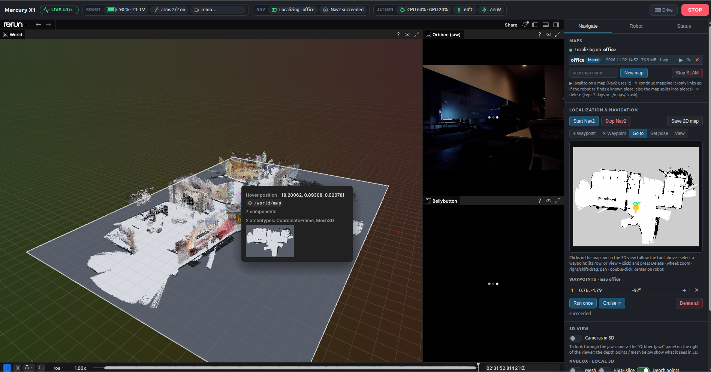
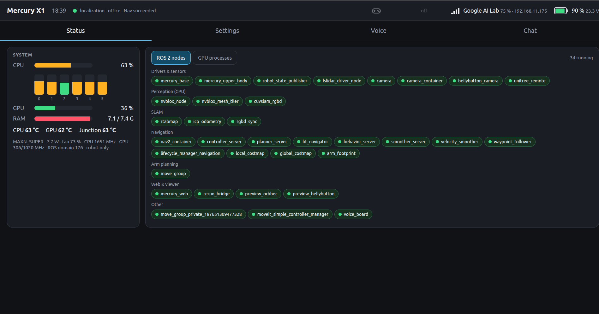

# mercury_x1_ros2

<p align="center">
  
</p>
<p align="center">
  
</p>

## New stack (2026): goalkeeper drivers + RTAB-Map + Nav2 + Rerun web UI

```bash
./deploy.sh                                   # rsync to elephant@192.168.11.175 (REMOTE_HOST=... to override)
ssh elephant@192.168.11.175 'cd ~/mercury_x1_ros2 && colcon build --packages-up-to mercury_x1_bringup mercury_x1_web'
ssh elephant@192.168.11.175 '~/mercury_x1_ros2/start.sh'             # whole stack: hardware + page + SLAM + Nav2
ssh elephant@192.168.11.175 '~/mercury_x1_ros2/scripts/mx1_up.sh'    # ... or only hardware + Rerun bridge + page
open http://192.168.11.175:8080               # SLAM / Nav2 / waypoints / teleop from the page
ssh elephant@192.168.11.175 '~/mercury_x1_ros2/scripts/mx1_stop.sh'  # stop everything (rtabmap saves the map)
```
**Autostart:** `scripts/install_autostart.sh` installs the systemd unit `mercury-x1` (`config/systemd/`),
which runs `./start.sh` at boot: SLAM continues the most recently saved map (`~/maps/*.db`) in mapping mode,
then Nav2. Override in `~/.config/mercury_x1/autostart.env` (`MX1_MAP=office`, `MX1_MODE=localization`,
`MX1_SLAM=false`, `MX1_NAV=false`). `sudo systemctl stop|start|restart mercury-x1`, `journalctl -u mercury-x1`.
The robot needs `RemoveIPC=no` (`/etc/systemd/logind.conf.d/90-mercury-keep-ipc.conf`): otherwise logind deletes
the stack's Fast-DDS shared memory whenever the last ssh session closes, and later processes can't connect.

**ROS environment** (`scripts/ros_env.sh`, sourced by every script and `~/mx1_env.sh`): `ROS_DOMAIN_ID=176`;
ROS network **robot only** (default: Fast-DDS UDP on loopback only, `config/fastdds_localhost.xml`, no DDS
multicast on the WiFi) or **LAN** (`config/fastdds_lan.xml`, other machines can join). The switch is on the page
(Robot tab, "ROS 2 network"); it is saved in `~/.config/mercury_x1/ros_network` and restarts the stack
(`scripts/mx1_restart.sh`), with SLAM / Nav2 resuming as they were. The page and viewer use HTTP / gRPC, so they
work in both modes.
Robot-side pip deps (user site): `rerun-sdk==0.39.0 aiohttp "pandas>=2.2,<3"` (the apt pandas breaks under numpy 2).
Rerun 0.39 is the newest release that supports Python 3.10 (Humble's rclpy); 0.40+ needs Python 3.11. The page
serves the matching `@rerun-io/web-viewer` (`VIEWER_VERSION` in `web_server.py`, fetched once from jsDelivr).

### Head display (:8081)
The head panel (1280x720 HDMI + USB touch) shows a lightweight touch UI served by `web_server` on
`http://<robot>:8081` (also usable from any browser): status bar (battery % / V / ⚡, Wi-Fi network,
signal, IP), **Status** (CPU per core, GPU, RAM, temperatures, ROS nodes as bubbles grouped by
subsystem, red when a needed one is missing) and **Settings** (Wi-Fi scan + connect with an on-screen
keyboard, arm power / freedrive, LED colour, Unitree remote). Status is pushed at 1 Hz; no Rerun.
The kiosk is `mercury-x1-head.service`: bare Xorg on tty1 + matchbox (kiosk WM) + surf (WebKitGTK),
`scripts/head_kiosk.sh`; ~4 % of one core, ~390 MB. Needs `sudo apt install surf matchbox-window-manager`.
Wi-Fi changes run `sudo -n nmcli` (NetworkManager falls back to the previous network if the new one fails).

### Mapping
Starting **mapping** levels the head first (neck 0°, jaw −5.7° = camera horizontal) and the page refuses
head moves while mapping runs; RTAB-Map's 2D grid uses the lidar **and** the depth camera
(`Grid/Sensor 2`), so tables / overhangs between 6 cm and 1.4 m end up in the saved map.
The page's **SLAM 3D map → Voxel map** layer is the whole map from the stored RGB-D frames: web_server sends
it at 3 cm, the bridge re-voxelises it at the page's size (3–20 cm) as round points or solid cubes, in 2 m tiles (`rtabmap-export`, re-exported only when the graph changed, ≤ every 30 s while
mapping; the bridge re-sends only changed tiles), fitted to the live map frame on the nodes both share
(`Grid/3D` stays off: a database reprocessed with it gave a 2D map of a single scan fan);
**Export cloud / Export mesh** write a .ply / zipped textured .obj via `rtabmap-export` to
`~/maps/exports` (downloads on the page). Exports copy the database byte-wise: never open the live
`.db` with SQLite while rtabmap runs (rtabmap aborts on "database is locked").

**Boot = localization** on the latest map (`./start.sh`); mapping only when the map does not exist.
Each mapping start opens a new session in the database, and sessions that never get linked by a loop
closure split the map (`office` had 24 sessions in 4 disconnected pieces). Map a place in one go.

### Maps, waypoints
Page → **Maps** lists `~/maps/*.db` (newest first, size, waypoint count, which one SLAM uses):
▶ localize, ✎ continue mapping, ✕ delete (moved with its waypoints / .pgm to `~/maps/.trash/`, purged
after 7 days; the map in use cannot be deleted). **New map** starts an empty map (an existing map of
that name goes to the trash first). Waypoints belong to a map (`<name>.waypoints.json`): ✕ per row,
**Delete all**, or the **✕ Waypoint** tool (click a waypoint on the 2D map or in the 3D view).

### Voice chat (head display → Chat tab)
Tap the microphone, then just speak. Speech runs on the robot; only text goes to Qwen on 11.51.
`arecord` on the XFM-DP mic array (16 kHz, beamformed on the board) streams to `mercury-speech` (`server/robot_speech`,
127.0.0.1:8097, own venv ~/mercury-speech with the Jetson onnxruntime-gpu wheel; `server/robot_speech/setup.sh`
installs it): Silero VAD finds phrases, NVIDIA Parakeet TDT 0.6B v2 transcribes them on the GPU (fp16 made on a PC
with `server/robot_speech/make_parakeet_fp16.py`, LayerNorm kept fp32; ~0.4 s for a short phrase, ~0.5 s for 7.7 s;
falls back to the int8 model on the CPU, ~0.4 / ~1.4 s), Kokoro speaks on the GPU (~0.35-0.8 s per sentence). The unit
compacts RAM before starting: fragmented memory made the GPU allocations fail (nvmap error 12) with GBs free.
`voice.py` in web_server sends the text to Qwen (pennyroyal proxy :11434, thinking off, ~0.2 s to first word), cuts
the reply into sentences (the opening clause goes first), `aplay` plays them on the C-Media speaker; the mic is muted
while it talks. ~2.3 GB of GPU memory in all (kiosk Status → GPU processes shows it). `server/voice_service`
(Whisper on 11.51, systemd `mercury-voice`) is the old remote speech service, disabled since 2026-11-02.
Config + bearer token: `~/.config/mercury_x1/voice.env` (chmod 600). The room's 150-300 Hz hum made webrtcvad
trigger 95 % of the time; Silero scores it ≤ 0.3.

### Voice board (iFlytek XFM-DP 4-mic array in the head)
`src/drivers/mercury_x1_voice_board` talks the AIUI serial protocol on `/dev/xf_mic` (udev rule in
`scripts/install_voice_board_udev.sh`): acks the handshake, publishes wake events (`VoiceWake`: keyword, beam 0-2,
angle 0-180°, score) and board state, services to set the wake word / fix the beam. Kiosk → **Voice** tab: wake-word
presets (factory 小微小微 `xiao3 wei1 xiao3 wei1`, threshold 700-1100, persisted in
`~/.config/mercury_x1/voice_board.json`), a direction radar with the last wakes, and the voice-output settings.
What the board is (Allwinner R818, Tina Linux, root ADB over its USB): one closed iFlytek library does beamforming/AEC/NS
(language-independent) and the wake word (IVW 3.8, `res.bin` = a **Mandarin-only** acoustic model + the keyword as
state IDs). The on-board keyword compiler maps English text to Chinese-accented approximations; "hello computer",
"hey memory" etc. never trigger, and no English `res.bin` exists publicly (Hiwonder's "hello hiwonder" firmware is
this same image; an English resource is a custom order from iFlytek). So: 小微小微 on the board for wake + direction;
an English detector would have to run on the Orin.
Raw mics: the board's USB audio is a configfs UAC1 gadget (`/etc/rc.local` on the board); `p_chmask` can be raised so
the Orin receives the AC107 channels directly (slots 1-4 = the 4 mics, 35 mm pitch; 5-8 are delayed copies). UAC1 in
that kernel caps packets at 200 B/ms, so at most 6 channels at 16 kHz (8 ch gave zero-filled samples); use `0x0f`.
Switching the function to UAC2 made the gadget fail to bind and took ADB down with it (a board power cycle restores
the stock config), so any board-side change must verify the bind and revert by itself. Host-side DOA/beamforming/
English wake word on those 4 channels is the planned replacement for the board's closed stack.

### Nav2 in one process
`nav.launch.py` runs all Nav2 servers in one `component_container_isolated` (`/nav2_container`, one executor
thread per server; `composition:=false` for separate processes): idle CPU 72 % → 51 % of a core.

### Arm-aware footprint
`nav.launch.py` also starts `arm_footprint` (C++, `src/arm_footprint.cpp`; `arm_footprint:=false` to skip): 5 Hz, the arm links'
mesh hulls (`config/arm_hulls.yaml`, from `mercury_x1_web/tools/arm_hulls.py`) + 8 cm for a hand beyond
each flange go through TF into base_footprint. If anything sticks out more than 5 cm past the
nav2.yaml outline, `/local_costmap/footprint` and `/global_costmap/footprint` get the convex hull of
the outline and those points (+4 cm); MPPI (`consider_footprint`) and the behaviours collide-check with
it. Published only on change (a new footprint makes the costmaps re-inflate). Arms hanging: outline.
(Different job from MoveIt below: this keeps the *driving* robot from clipping things with an arm held out;
MoveIt plans the *arm* motions themselves.)

### Arms: MoveIt (planning, IK, self-collision)
`src/control/mercury_x1_moveit_config`, started from the page (Robot → Light & arms → Motion planning) or
`ros2 launch mercury_x1_moveit_config move_group.launch.py`. Groups: `left_arm`, `right_arm` (7 joints off the
torso), `both_arms`, `left_arm_waist` / `right_arm_waist` (+ the waist), `waist`; named states `rest`
(arms hanging) and `straight` (waist). Self-collision = arm vs arm, arm vs torso/head/base, with one convex hull
per link (`mercury_x1_description/meshes/collision`, `tools/make_collision_meshes.py`; the vendor URDF collided with
the 125 MB visual meshes). Pairs that can never touch are disabled in the SRDF by `collisions_updater`:
```
xacro src/core/mercury_x1_description/urdf/mercury_x1.urdf.xacro > /tmp/mx1.urdf
ros2 run moveit_setup_assistant collisions_updater --urdf /tmp/mx1.urdf --srdf <srdf> --output <srdf> \
    --default --always --trials 10000 --min-collision-fraction 0.95
```
IK: KDL (pick_ik optional). Speed limits are guesses (URDF says 0): arms 1 rad/s, waist 0.5 rad/s, plans at 30 %.
Execution: the upper-body driver serves `{left_arm,right_arm,waist}_controller/follow_joint_trajectory`: the
path is reduced to its corners (Douglas-Peucker, within `trajectory_path_tolerance_deg` 2° of the plan; the firmware stops at every queued target, so fewer moves = smoother), each segment's firmware speed comes from
the trajectory timing (`speed_deg_s_at_100` = 150, measured), all moves go
to the firmware queue at once, done when joint_states reach the last point (`goal_tolerance_deg` 2°), stopped
on cancel / timeout. Off-robot: `ros2 launch mercury_x1_moveit_config demo.launch.py` (mock driver) and
`ros2 run mercury_x1_moveit_config check_moveit.py [--execute]`.

### 3D view layers
The Rerun server keeps 64 MiB of history and replays it **newest first** to a new viewer (the live view shows
at once, history fills in behind).

Page → "3D view": **Cameras in 3D** (frustums of the jaw and bellybutton cameras with the live image, 2 Hz; default on),
nvblox: Mesh + Depth points (default; shown as 5 cm voxels, mapping uses the full depth), ESDF slice (distance to obstacles at the costmap slice height,
what Nav2 uses), Depth points (back-projected depth, downsampled to 40k), TSDF voxels, Colour voxels,
Occupancy. The choice is the `nvblox_layers` parameter of `rerun_bridge`, saved in
`~/.config/mercury_x1/viz_layers.json`; layers that are off are not subscribed at all.

### Clicking in 3D
The map is logged as a pickable floor mesh: a plain click on it is sent to the robot and becomes a
waypoint / go-to goal / initial pose / nothing, depending on the click mode chosen on the page
(+ Waypoint · ✕ Waypoint · Go to · Set pose · View). Clicks on the robot model and camera images are ignored.

Keyboard driving: the **⌨ Drive** button (W/A/S/D or arrows, Shift = fast, Space = stop, Esc releases).

| Package | What |
|---|---|
| `src/drivers/mercury_x1_driver` | C++ `base_node` (odom+TF, IMU, battery %, ultrasonic L/back/R, RGB LED, cmd_vel watchdog, rear guard) and `upper_body_node` (both arms + neck/jaw/waist: 50 Hz joint states, ArmState with flange coords, preemptible joint/Cartesian commands, power/stop services). Exclusive serial ownership. |
| `src/core/mercury_x1_msgs` | `ArmState`, `BaseState`, `JointCommand`, `CartesianCommand` |
| `src/core/mercury_x1_description` | URDF + calibrated sensor frames (base_footprint = drive axle) |
| `src/bringup/mercury_x1_bringup` | `robot.launch.py`, `slam.launch.py mode:=mapping\|localization map:=<name>`, `nav.launch.py` (+ `arm_footprint`, C++) |
| `src/visualization/mercury_x1_web` | `rerun_bridge` (TF-aware Rerun scene, gRPC :9876, viewer :9090) + `web_server` (:8080) |

Key topics: `/cmd_vel`, `/odom` (lidar ICP), `/wheel/odom`, `/imu/data_raw`, `/battery`, `/ultrasonic/{left,back,right}`, `/base/led`,
`/joint_states`, `/{left,right}_arm/state`, `/upper_body/joint_command`, `/upper_body/cartesian_command`,
services `/{left,right}_arm/power`, `/{left,right}_arm/stop`, `/upper_body/stop`. Maps: `~/maps/<name>.db` (+ `.waypoints.json`).

Protocol notes and calibration: `mercury_x1_devlog/software/mercury-x1-low-level-protocols.md`.

---

## Original vendor README
Use of Mercury X1 mobile chassis ROS2

## Support  
- ROS 2 Humble ✅

## To-Do  
- [x] URDF model  
- [x] Real-time joint state synchronization  
- [ ] Real-time IMU data synchronization  
- [x] Laser scan integration (2D Lidar)
- [x] Real-time joystick control  
- [ ] Ultrasonic sensors integration 
- [ ] RGB Cameras stream integration 
- [ ] RGB Cameras distortion calibration 
- [ ] RGBD (Deopth) Camera stream integration  
- [ ] Foxglove WebSocket bridge  
- [ ] SLAM (using `slam_toolbox`)  
- [ ] Navigation (using `nav2`)  


## Package Download and Install

```bash
source /opt/ros/humble/setup.bash 

git clone --recurse-submodules https://github.com/elephantrobotics/mercury_x1_ros2.git
cd ~/mercury_x1_ros2
rosdep install --from-paths src --ignore-src -y --rosdistro humble
colcon build    # Compile all function packages
ource install/setup.bash

# Compile the function package separately:
If you only compile “mercury_bringup“, you need to execute the command:
colcon build --packages-select mercury_bringup
```
# 一、Mercury Seven Axis

>> **Note**:  Make sure the machine is powered on and enabled before use

## Bottom car keyboard control

**1. First start the car's underlying communication program and map building:**

```bash
$ ros2 launch slam_gmapping slam_gmapping.launch.py
```

**2. Then start the keyboard control program:**

```bash
$ ros2 run mercury_x1_control mercury_keyboard
```

## Chassis car + upper body robotic arm control

**1. First start the car's underlying communication program and map building:**

```bash
$ ros2 launch slam_gmapping slam_gmapping.launch.py
```

**2. Then Turn on upper body robotic arm control:**

```bash
$ ros2 run mercury_x1_control slider_control
```

**3. Finally start the keyboard control program:**

```bash
$ ros2 run mercury_x1_control mercury_keyboard
```

# 二、Mercury Turing Six Axis

>> **Note**:  Make sure the machine is powered on and enabled before use

## Bottom car keyboard control

**1. First start the car's underlying communication program and map building:**

```bash
$ ros2 launch slam_gmapping slam_gmapping_turing.launch.py
```

**2. Then start the keyboard control program:**

```bash
$ ros2 run mercury_x1_control mercury_keyboard
```

## Chassis car + upper body robotic arm control

**1. First start the car's underlying communication program and map building:**

```bash
$ ros2 launch slam_gmapping slam_gmapping_turing.launch.py
```

**2. Then Turn on upper body robotic arm control:**

```bash
$ ros2 run mercury_x1_control slider_control_turing
```

**3. Finally start the keyboard control program:**

```bash
$ ros2 run mercury_x1_control mercury_keyboard
```

# Common ROS 2 Commands Summary:

```bash
# Build a single package:
# Example: build only mercury_bringup
colcon build --packages-select mercury_bringup

# Build all packages:
colcon build

# Note: After modifying launch files, you must recompile for changes to take effect.

# NFS Mount
sudo mount -t nfs 192.168.0.100:/home/er/mercury_x1_ros2/ /mnt


# 1. Launch robot base
# Mercury Seven Axis
ros2 launch mercury_bringup mercury_bringup.launch.py
# Mercury Six Axis
ros2 launch mercury_bringup mercury_bringup_turing.launch.py


# 2. Launch camera
ros2 launch mercury_bringup mercury_camera.launch.py


# 3. Launch LiDAR
ros2 launch mercury_bringup mercury_lidar.launch.py


# 4. Keyboard control for mobile base
ros2 run mercury_x1_control mercury_keyboard


# 5. Simple following capabilities
# ① LiDAR-based following
ros2 launch simple_follower_ros2 laser_follower.launch.py

# ② Vision-based line following
ros2 launch simple_follower_ros2 line_follower.launch.py

# ③ Vision-based object tracking
ros2 launch simple_follower_ros2 visual_follower.launch.py


# 6. 2D SLAM (Mapping)
# ① Mapping with gmapping
# Mercury Seven Axis
ros2 launch slam_gmapping slam_gmapping.launch.py
# Mercury Six Axis
ros2 launch slam_gmapping slam_gmapping_turing.launch.py

# ② Mapping with slam_toolbox
ros2 launch mercury_slam_toolbox online_async.launch.py

# ③ Mapping with Cartographer
ros2 launch mercury_cartographer cartographer.launch.py

# Save map
ros2 launch mercury_nav2 save_map.launch.py


# 7. 2D Navigation
ros2 launch mercury_nav2 mercury_nav2.launch.py


# 8. RRT-based autonomous exploration & mapping  
# [Publish four waypoints clockwise/counterclockwise; the last point must be in the known map area]
# Step 1:
ros2 launch mercury_slam_toolbox online_sync.launch.py
# Step 2:
ros2 launch mercury_robot_rrt mercury_rrt_slam.launch.py


# 9. RTAB-Map SLAM
ros2 launch mercury_robot_rtab mercury_slam_rtab.launch.py


# 10. RTAB-Map Navigation
ros2 launch mercury_robot_rtab mercury_nav2_rtab.launch.py


# 11. USB Joystick Control
ros2 launch mercury_joy mercury_joy.launch.py


# 12. Launch RViz2
# Note: Use a virtual machine to run RViz2


# 13. Full robot control (mobile base + upper-body manipulator)
# ① Mapping with gmapping
# Mercury Seven Axis
ros2 launch slam_gmapping slam_gmapping.launch.py
# Mercury Six Axis
ros2 launch slam_gmapping slam_gmapping_turing.launch.py

# ② Launch upper-body manipulator control
# Mercury Seven Axis
ros2 run mercury_x1_control slider_control
# Mercury Six Axis
ros2 run mercury_x1_control slider_control_turing

# ③ Keyboard control for mobile base
ros2 run mercury_x1_control mercury_keyboard
```